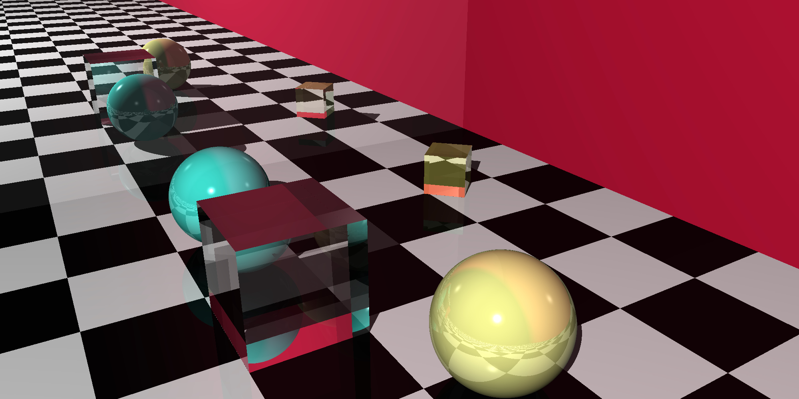

# RayTracer

A from-scratch ray tracer written in C++17, with a GoogleTest unit-test suite.



## Features

- **Primitives:** spheres, planes, cubes, cylinders, cones, triangles, smooth triangles
- **Composition:** groups and constructive solid geometry (CSG)
- **Meshes:** triangle mesh file loading
- **Materials and patterns:** stripe, gradient, ring, and checker patterns
- **Lighting:** point lights with shading and shadows
- **Reflection and refraction:** mirrored and glass-like surfaces
- **Rendering:** configurable camera and canvas output

## Build

The project uses qmake (`RayTracerProject.pro`) and requires [GoogleTest](https://github.com/google/googletest).

1. Clone GoogleTest and update the `INCLUDEPATH` and `gtest-all.cc` / `gmock-all.cc` paths in `RayTracerProject.pro` to point to your copy.
2. Build:

   ```sh
   qmake RayTracerProject.pro
   make
   ```

## Project layout

| Files | Purpose |
|-------|---------|
| `Tuple`, `Matrix`, `Color`, `Transformer` | Math and color primitives |
| `Ray`, `Intersection`, `Shape`, `Sphere`, `Plane`, `cube`, `cylinder`, `cone`, `triangle`, `csg`, `group` | Geometry |
| `Material`, `Light`, `Pattern`, `Stripe`, `Gradient`, `Rings`, `checker` | Shading |
| `World`, `Camera`, `Canvas` | Scene and rendering |
| `*Test.cpp` | Unit tests |

## Acknowledgments

Based on *The Ray Tracer Challenge* by Jamis Buck.
